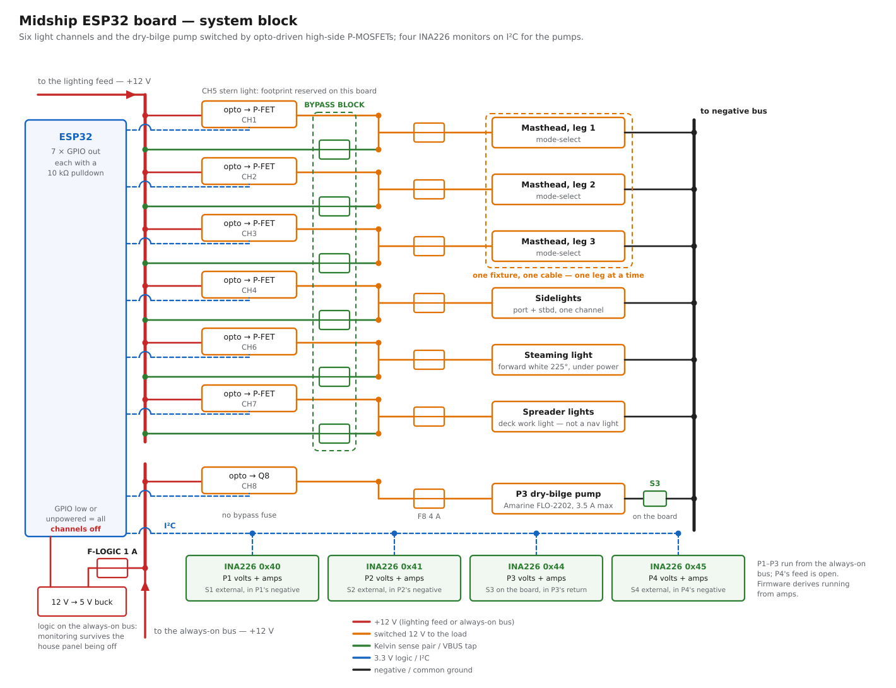
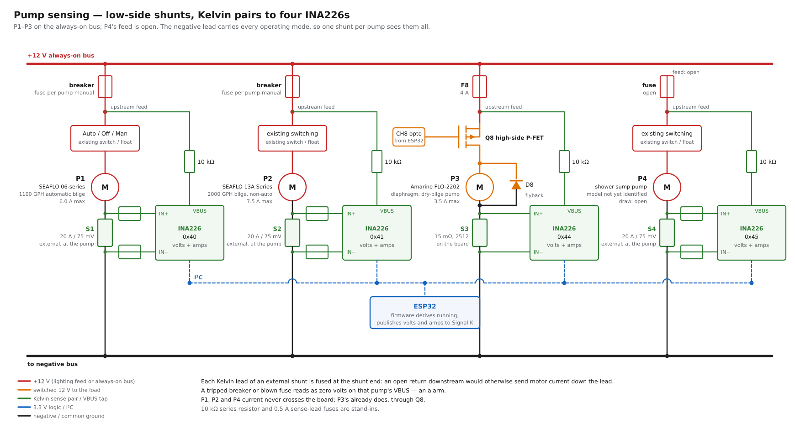

# Midship ESP32 board — mast lights, forward sidelights, three-pump monitoring

One ESP32 board under the port dinette settee (position 2). It switches the
mast lights and the forward sidelights, switches the dry-bilge pump, and
measures volts and amps on three pumps. The IMU and the paddlewheel are not on
this board.

**Scope:** from the two feeds arriving at the board (the lighting feed and the
always-on bus) to the terminals where each fixture's or pump's pair lands.
Nothing upstream of those feeds, nothing inside the fixtures or pumps.

Every number marked *stand-in* is a working placeholder, not a specification.
Numbers marked *calculated* come from datasheet figures and have not been
measured on this board.

## Diagrams

| | |
|---|---|
| [System block](midship-board-block.svg) | light channels, the pump channel, three INA226s on I²C |
| [Pump sensing](midship-board-sensing.svg) | shunts in the negative leads, Kelvin pairs, Q8 and D8 |

Regenerate both from the repo root:

```bash
python3 diagrams/electrical/midship-board-diagrams.py
```



## Light channels

Identical to [nav-light-controller.md](nav-light-controller.md): an
opto-driven high-side P-MOSFET, a branch fuse, and a normally-empty bypass
fuse block. That document owns the circuit, the fail-off behaviour and the
masthead radio-group rule. Lights are fed from the lighting feed.

| | Channel | Fixture |
|---|---|---|
| CH1–CH3 | Masthead, legs 1–3 | mode-select legs of the masthead unit |
| CH4 | Sidelights | port + starboard, one channel |
| CH6 | Steaming light | forward-facing white 225° |
| CH7 | Spreader lights | deck work light — not a navigation light |
| CH8 | Dry-bilge pump (P3) | see below |

CH5, the stern light, goes to the aft node, not this board.

A future channel is cabin-light switching. It is deferred and has no
footprint here yet.

## Pumps

All three run from the always-on bus. The ESP32's logic supply (F-LOGIC and
buck) also comes from the always-on bus, so monitoring keeps working with the
house panel off.

| | Pump | Max draw | Fuse | Switching | Shunt |
|---|---|---|---|---|---|
| P1 | SEAFLO 06-series 1100 GPH automatic bilge | 6.0 A (retailer listing) | per the pump's manual | its existing Auto/Off/Man panel switch and float; the board does not switch it | S1, external, 20 A / 75 mV (3.75 mΩ), in the pump's negative |
| P2 | second SEAFLO bilge pump, model not yet identified; "slightly higher" draw | open | open | same as P1 | S2, external, 20 A / 75 mV, in the pump's negative |
| P3 | Amarine FLO-2202 12 V diaphragm pump, 4.3 L/min, 35 PSI — the "dry bilge" pump | 3.5 A max (label) | 4 A (label: "4A FUSE REQ'D") | CH8: opto and high-side P-MOSFET Q8 on the board; D8 flyback across the motor; F8 4 A; no bypass fuse | S3, 15 mΩ 2512 resistor on the board, in P3's negative return |

The crash pump is near the engine room and is not on this controller.



### Why the shunts are in the negative lead

An Auto/Off/Man switch, or a 3-wire automatic pump, feeds the motor through two
positive leads. One positive-side shunt would miss a mode. The negative lead
carries every mode. Sense leads on the negative side need no fuse, and the
INA226's common-mode range covers near-0 V.

### Why P1 and P2 are external and P3 is on the board

Bilge-pump current stays off the board, so a board fault cannot stop a bilge
pump. P3's current already crosses the board through Q8, so an on-board shunt
adds no failure path.

### Shunt sizing (*calculated*, INA226 datasheet: 2.5 µV shunt LSB, 81.92 mV full scale)

| | Full scale | Current LSB | At the pump's draw |
|---|---|---|---|
| S1, S2 (3.75 mΩ) | 21.8 A | 0.67 mA | 22.5 mV, 0.14 W at 6 A |
| S3 (15 mΩ) | 5.46 A | 0.17 mA | 52.5 mV, 0.18 W at 3.5 A |

S1 and S2 stay inside two-thirds of the shunt's 20 A rating, the continuous
derating, up to about 13 A, so they cover P2 whatever its draw turns out to be
within that.

### What each INA226 reports

| | Address | Shunt | Publishes |
|---|---|---|---|
| P1 | 0x40 | S1 | volts, amps |
| P2 | 0x41 | S2 | volts, amps |
| P3 | 0x44 | S3 | volts, amps |

Firmware derives `running` from amps.

Each INA226's bus-voltage pin taps that pump's breaker-side feed through a
series resistor (*stand-in*, 10 kΩ). A tripped breaker therefore reads as zero
volts, which is an alarm.

## Dry-bilge pump behaviour (firmware requirements)

- **Runtime cap is the hard stop**, a config value. It is required because a
  pressure-type diaphragm pump tolerates only short dry runs.
- **Current-drop "bilge is dry" detection is unproven.** Dry and wet current
  have to be measured on the bench before it gates anything.
- *Guess:* the FLO-2202's 35 PSI rating suggests a built-in pressure switch.
  Discharging overboard it should never reach cutoff, so "commanded on, about
  0 A" would mean a blocked outlet, for example a closed seacock. That is an
  alarm.
- **Fails off:** unpowered, booting or hung-low means Q8 is off, as for every
  light channel.

## Open questions

- P2's model, its draw and its fuse.
- What triggers the dry-bilge pump: a schedule, a float, or a manual Signal K
  PUT.
- Whether P3 has a pressure switch. Check on the bench.
- The nav-light open questions (masthead legs, two legs hot at once, ESP32
  dedicated or shared) carry over from
  [nav-light-controller.md](nav-light-controller.md).
